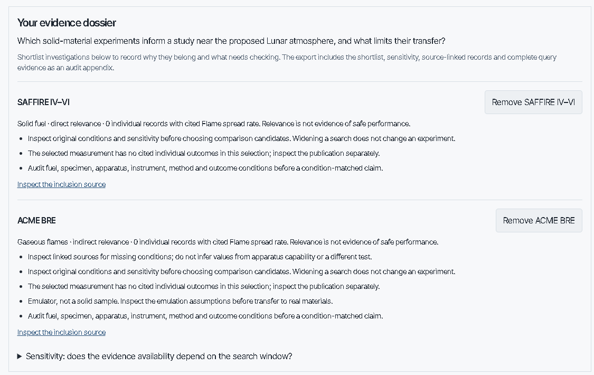

#  Flame Freefall

> Traceable NASA combustion evidence for researchers deciding what to investigate next.
> Search by atmosphere, fuel and flow; inspect individual records; export the evidence
> and the query that selected it.

**Built for NASA Space Apps Challenge 2026: Flame in Freefall: SI-Powered Fire Safety Insights from Microgravity Combustion Data**

[](https://github.com/marjan-ahmed/flame-freefall/actions/workflows/validate.yml)
[](https://github.com/marjan-ahmed/flame-freefall/actions/workflows/validate-psi.yml)
[](LICENSE)

[Live dashboard](https://marjan-ahmed.github.io/flame-freefall/) •
[Explorer](https://marjan-ahmed.github.io/flame-freefall/explore/) •
[Governed record](https://marjan-ahmed.github.io/flame-freefall/docs/) •
[Seven-slide demo (PDF)](docs/presentation/flame-freefall-pitch.pdf)

**Muhammad Marjan Ahmed, solo builder**

> [!WARNING]
> **Competition eligibility is unresolved.** This project existed before the November 2026
> hackathon. Technical improvements are not a claim of eligibility. See
> [submission gates and disclosure](SUBMISSION.md) before representing it as an entry.

> [!NOTE]
> Local changes do not update the live deployment until published.

## What it is

Flame Freefall indexes microgravity combustion experiments from the PSI collection and
governed literature, and lets a researcher ask one question: which indexed experiments
overlap a proposed atmosphere, and how sensitive is that answer to the search method?



The deterministic Explorer works without an AI service. Chat is optional; for the
dependable demo, use the static Explorer.

## Try it

1. Open the Lunar evidence table on the [home page](https://marjan-ahmed.github.io/flame-freefall/).
   Compare the default search, the tighter pressure window and the wider oxygen window.
2. Inspect direct solid-fuel tests, BRE condensed-fuel emulation and other gaseous flame
   experiments separately. BRE remains gaseous by physical geometry; its scientific role
   is indirect evidence about condensed fuels.
3. Follow a result to the Explorer. Adjust tolerances and inspect the source table, raw
   condition cells, missing metadata and disagreements.
4. Download the evidence JSON. It includes every matching, incomplete and remaining record
   in the selected categorical scope, plus source references, query settings, method version
   and dataset SHA-256. It is a research starting point, not a validated model-training dataset.

At `/decide/`, record a research question, select explicit conditions and a measurement
focus, then shortlist investigations. The evidence dossier preserves classification quotes,
source-linked records, unknown conditions, retrieval sensitivity and next source checks,
and its versioned export contains the shortlist plus the complete evidence appendix.
The `/decide/` route lives in the repo; it reaches the public site only after publication.

## Features

- **Deterministic search.** Full matches report every requested axis within a numerical
  search window; incomplete matches lack at least one requested condition. Neither tier
  proves physical equivalence.
- **Sensitivity built in.** The default search uses ±1.5 oxygen percentage points and
  ±0.1 atm pressure. These are retrieval heuristics, not safety margins. The Explorer
  exposes them and preserves changes in the URL and download.
- **Granularity kept honest.** Individual tests, test points, daily summaries and planned
  envelopes are distinct. Mission views use only individual tests and test points, and
  heatmaps count only scalar paired conditions from individual records. An empty cell is
  an absence in the plotted subset, not a zero.
- **Exploratory rankings, labelled as such.** Rankings are measurement summaries, not
  flammability or safety rankings. Each eligible measurement stays an individual
  observation with no pooled material estimates, and every contributing ID is retained.
- **Tool-grounded chat.** PSI chat measurements render in deterministic widgets.
  Current-message condition binding prevents silent model-added pressure or flow filters;
  ambiguous requests are refused rather than guessed. Chat history is temporary; exported
  dossiers are the reproducible record. Uploads are not offered in this workflow.
- **Source-linked narrative retrieval.** Governed documents are published through
  KSOR/pgvector and served through the MCP door. Document and phrase checks bound the
  engineering claim; they do not establish answer correctness or independent review.

## Scientific boundaries

> [!CAUTION]
> - Microgravity results do not validate Lunar or Martian gravity predictions.
> - Missing data is not proof of safety, and not proof that no research exists.
> - PSI daily summaries retain their missing pressure; it is never inferred from another test.
> - Ambient conditions in [NASA-STD-6001B](https://standards.nasa.gov/standard/nasa/nasa-std-6001)
>   are a reference definition, not a universal material certification atmosphere.

See [method and export dictionary](docs/evidence-method.md) and the
[demonstration script](DEMO.md) for reproducible interpretation.

## Data and evidence

Verified against the ingest report at `psi-data/derived/ingest-report.json`
(generated 2026-11-02):

| Measure | Count |
| --- | --- |
| Indexed records | 1,951 |
| Records with outcomes | 1,035 |
| Investigations | 19 |
| Individual tests / test points | 1,403 / 435 |
| Daily summaries / planned envelopes / summaries | 100 / 8 / 5 |

There are 23 stable governed documents, published as vector generation 10
(284 chunks). A public MCP evaluation of generation 10 retrieved the expected
document for all 13 target questions and abstained on all 8 out-of-scope controls.
The SAFFIRE SIBAL cross-check attribution was corrected from VI-3 to VI-2.

[Internal scientific evaluation](research/scientific-evaluation.md) and its
[reproducible script](scripts/evaluate-scientific-evidence.py) examine paired
burns, comparability, missingness, uncertainty and conditional energy consistency.
This is an internal source-based review, not NASA endorsement, independent
scientific peer review or predictive validation. Rows with report data are not
necessarily independently confirmed measurements, and governance stamps are
recorded attestations, not certified human review.

## Architecture and trust

| Layer | Implementation | Boundary |
| --- | --- | --- |
| Record | Governed CommonMark in `knowledge/` | Source statements, citations, approval metadata |
| Ingest | `system/psi-ingest` | Preserves raw cells, units, source conflicts and granularity |
| Query | Python and TypeScript twins | Deterministic filtering and exploratory ranking, pinned by fixtures |
| Site | Next.js static export | Home dashboard, source record and browser-only Explorer |
| Assistant | FastAPI, ChatKit, openai-agents | Tool-rendered evidence, optional model prose |
| Narrative retrieval | KSOR MCP, embeddings, Postgres | Separately deployed; health is not retrieval validation |

The assistant uses one configured Qwen model via XKIRO for optional chat responses.
No multi-provider fallback is claimed. Tool and citation guards reduce some failure
modes; they do not prove that every model statement is true. Both the structured
query path and the governed-document path must be refreshed after changes; building
the website alone does not ingest vectors.

## Local development

Prerequisites: Node.js, Python with `uv`, and a local Sentence Transformers service
for narrative answers (see [`system/sentence-transformers/README.md`](system/sentence-transformers/README.md)).

```sh
npm install
npm run dev              # the record, at http://localhost:3000
```

```sh
cd system/psi-ingest
uv run psi-ingest        # raw + knowledge/ + extracted → psi-data/derived/*.json
uv run pytest            # ingest invariants: every row accounted for, every value keeps its raw cell
```

```sh
cd system/chatkit-server
uv sync
uv run uvicorn main:app --reload --port 8000    # the chat backend
GROQ_API_KEY=dummy uv run pytest                # query, ranking, readiness + widget tests (no network)
```

```sh
npm --prefix system/site run test:psi   # the in-browser query/ranking matches the Python one
npm run check                           # governed-record format checks
npm run build
```

Generated files must be regenerated, never hand-edited. Expected failures mark known
defects; they are not proof that those behaviors are correct.

> [!NOTE]
> **Windows dev:** Git Bash rewrites `/flame-freefall` in env vars to a Windows path.
> Prefix builds with `MSYS_NO_PATHCONV=1 MSYS2_ENV_CONV_EXCL='*'`. Clone with
> `git -c core.longpaths=true` (long PDF names in `narrative_reports/`). Only one
> `next dev` per project. The full runbook, governance model and troubleshooting
> table are in [`AGENTS.md`](AGENTS.md).

## Deployment

| Service | Host | Why |
| --- | --- | --- |
| Site (static export) | GitHub Pages | Free, zero-config for a pure static export |
| Chat backend (FastAPI) | Vercel | Serverless fits a request-scoped LLM call |
| MCP door and embeddings API | Vercel (container runtime) | Separate `door` and `embeddings` containers |
| Corpus store | Neon (Postgres + pgvector) | Managed, scales to zero, free tier includes pgvector |

```sh
curl https://flame-freefall-site.vercel.app/health     # chat backend
curl https://flamefreefall-sor.vercel.app/health       # MCP door
curl https://flamefreefall-sor.vercel.app/ready        # door ↔ database
```

Pushes to `main` trigger the deployment workflows; their outcome must be checked
separately from local validation and vector publication.

## References, rights and AI assistance

[MIT license](LICENSE) covers project-authored code and documentation. It does not
settle redistribution rights for bundled scientific reports and datasets; see the
[references and licensing inventory](REFERENCES.md). AI-assisted code and record
creation are disclosed in [SUBMISSION.md](SUBMISSION.md); approval metadata must
never be manufactured to make a build pass.
