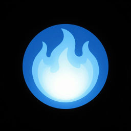

<div align="center">



# Flame Freefall

**Explore NASA microgravity combustion evidence, trace it to its source, and identify what still needs to be tested.**

[Live demo](https://marjan-ahmed.github.io/flame-freefall/) · [Evidence Explorer](https://marjan-ahmed.github.io/flame-freefall/explore/) · [Research workflow](https://marjan-ahmed.github.io/flame-freefall/decide/) · [Project presentation](docs/presentation/flame-freefall-pitch.pdf)

</div>

## Overview

Fire behaves differently in microgravity, making results from individual combustion investigations difficult to compare or apply to new research questions. Flame Freefall brings source-linked NASA combustion records into one research workflow: explore experimental conditions, compare relevant evidence, inspect gaps, and export the basis for each selection.

The **Evidence Explorer runs deterministically in the browser**, without requiring an AI service. An optional assistant supports source-grounded questions through separate structured-data and document-retrieval tools.

## What you can do

- **Find relevant experiments.** Filter indexed tests by oxygen concentration, pressure, fuel, flow, and other recorded conditions.
- **Understand evidence coverage.** Distinguish complete condition matches, incomplete records, and experiments outside a chosen window.
- **Inspect original context.** Follow record IDs and citations, review raw values, missing metadata, source disagreements, and experimental granularity.
- **Compare without hiding uncertainty.** Keep gaseous flames, direct solid-fuel tests, and indirect condensed-fuel evidence distinguishable.
- **Export reproducible results.** Save the selected conditions, evidence records, source references, method version, and dataset fingerprint.
- **Build a research dossier.** Use the decision workflow to shortlist evidence and identify the next source checks, without presenting exploratory matches as validated predictions.

## Try the Lunar atmosphere case study

The home dashboard examines how indexed combustion experiments overlap a proposed Lunar atmosphere, and how the result changes with search tolerances.

1. [Open the dashboard](https://marjan-ahmed.github.io/flame-freefall/) and review the Lunar evidence table.
2. Compare direct solid-fuel experiments, gaseous tests, and indirect BRE evidence separately.
3. [Open the Explorer](https://marjan-ahmed.github.io/flame-freefall/explore/) to adjust conditions, inspect individual records, and review missing values.
4. Export the evidence JSON to preserve the records and search method behind your findings.

For a guided walkthrough, see [DEMO.md](DEMO.md) or the [seven-slide presentation](docs/presentation/flame-freefall-pitch.pdf).

> [!IMPORTANT]
> **This is an exploratory research tool, not a fire-safety certification or predictive simulator.** A search match indicates recorded condition overlap within chosen tolerances, not physical equivalence. Microgravity experiments do not validate Lunar or Martian gravity predictions, and missing indexed evidence does not establish safety.

## How it works

| Component | Purpose | Location |
| --- | --- | --- |
| Governed evidence | Source-linked scientific documents and approval metadata | [`knowledge/`](knowledge/) |
| Data ingestion | Preserve raw source values, units, conflicts, and test granularity | [`system/psi-ingest/`](system/psi-ingest/) |
| Evidence query | Deterministic filtering and exploratory ranking in Python and TypeScript | [`system/`](system/) |
| Research interface | Next.js dashboard, Explorer, and dossier workflow | [`system/site/`](system/site/) |
| Optional AI assistant | FastAPI, ChatKit, and tool-backed evidence responses | [`system/chatkit-server/`](system/chatkit-server/) |
| Document retrieval | KSOR MCP, embeddings, and Postgres with pgvector | [`instance.md`](instance.md) |

Structured experimental measurements and narrative document retrieval follow separate paths. The site is statically deployed on GitHub Pages; the optional backend and MCP services are deployed independently. See [`AGENTS.md`](AGENTS.md) for the full engineering runbook.

## Getting started

**Requirements:** Git, Node.js 24 or later, and npm. Python tooling uses [`uv`](https://docs.astral.sh/uv/) for ingestion and backend development.

```bash
git clone https://github.com/marjan-ahmed/flame-freefall.git
cd flame-freefall
npm install
npm run dev
```

Open `http://localhost:3000` to explore the site. The browser-based evidence workflow does not require the optional chat backend.

To validate the project:

```bash
npm run check
npm --prefix system/site run test:psi
npm run build
```

For ingestion, optional AI services, environment configuration, and additional tests, see [`AGENTS.md`](AGENTS.md), [`.env.example`](.env.example), and the [Sentence Transformers setup](system/sentence-transformers/README.md). Keep credentials out of version control.

## Evidence and limitations

Flame Freefall keeps individual tests and test points separate from daily summaries and planned experimental envelopes. It does not fill unknown experimental conditions with inferred values. Heatmaps and exploratory rankings use narrower eligible subsets than the full searchable index, so an empty plot cell is not evidence that an experiment never occurred.

The data and source-review process are documented in the [evidence method](docs/evidence-method.md), [source inventory](psi-data/derived/source-inventory.md), and [scientific evaluation](research/scientific-evaluation.md). These are internal engineering and source-based checks, not independent peer review or NASA endorsement.

> [!NOTE]
> Flame Freefall is an independent, AI-assisted research software project, not an official NASA application. Project history, competition eligibility disclosures, and the distinction between deployed and unpublished changes are recorded in [`SUBMISSION.md`](SUBMISSION.md).

## Further reading

[Evidence method](docs/evidence-method.md) · [Source references and third-party rights](REFERENCES.md) · [Research evaluation](research/scientific-evaluation.md) · [Engineering runbook](AGENTS.md) · [Presentation and speaker notes](docs/presentation/README.md)

<sub>Built by Muhammad Marjan Ahmed · Code Nashai</sub>
